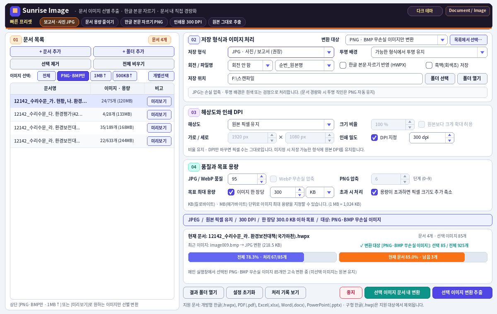
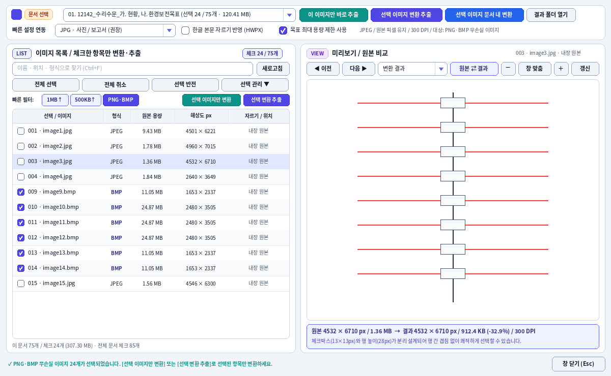
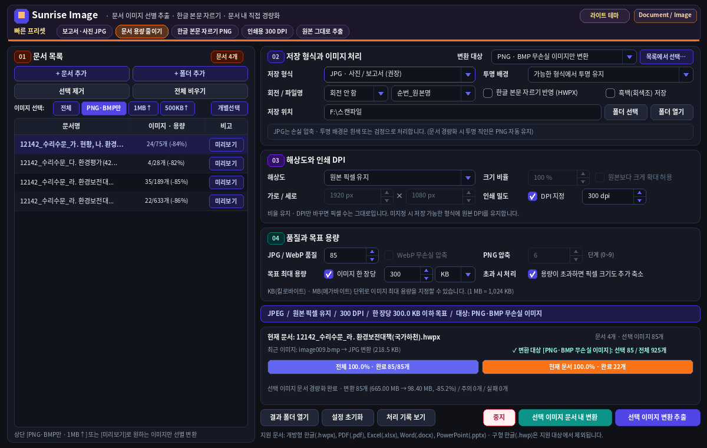

# Sunrise Image

**Sunrise Image**는 Windows 환경에서 한글 HWPX, PDF 및 Microsoft Office 문서에 포함된 이미지를 확인·선별·추출하고, 문서 내부 이미지의 품질과 크기를 조절하여 **경량화 사본**을 만드는 Python 기반 데스크톱 프로그램입니다.

> 이 저장소는 Python 소스코드와 Windows 빌드 스크립트를 제공합니다. 사전 빌드된 실행 파일이나 설치 프로그램이 포함된 것은 아닙니다.

## 지원 문서 형식

| 형식 | 이미지 추출 | 문서 내 이미지 변환·경량화 |
| --- | --- | --- |
| 한글 HWPX (`.hwpx`) | 지원, 본문 자르기 영역 반영 가능 | 지원 |
| Word (`.docx`) | 지원 | 지원 |
| Excel (`.xlsx`) | 지원 | 지원 |
| PowerPoint (`.pptx`) | 지원 | 지원 |
| PDF (`.pdf`) | 지원, 내장 및 인라인 이미지 | **지원하지 않음** |

구형 바이너리 문서 `.hwp`, `.doc`, `.xls`, `.ppt`는 지원하지 않습니다. 구형 한글 파일은 한글 프로그램에서 **HWPX로 다시 저장**한 후 사용하세요.

## 주요 기능

- **문서 일괄 등록:** 파일·폴더 추가, 드래그 앤 드롭, 문서별 이미지 목록 분석
- **조건별 이미지 선택:** 이미지 형식과 용량에 따라 대용량 이미지 또는 PNG/BMP 이미지 선별
- **이미지 변환 추출:** 원본 그대로 추출하거나 JPG·PNG·WebP·TIFF로 변환; 회전·해상도·인쇄 DPI·목표 KB/MB·저장 파일명 설정
- **HWPX 본문 자르기 반영:** 본문에 배치된 이미지의 Crop 정보를 분석하여 표시 영역 기준으로 추출
- **투명도 보호:** 투명 배경 유지 설정 시 직인·서명·로고 등 알파 채널이 포함된 이미지를 보호
- **미리보기:** 이미지 목록, 확대/축소, 이전/다음 이동, 원본과 변환 예상 결과 비교 및 단일 이미지 추출
- **문서 경량화 사본 생성:** HWPX 및 Office 문서의 선택 이미지를 변환하고 원본과 별도의 파일로 저장
- **작업 진행률:** 전체 및 현재 문서 진행률, 처리 상태, 중지 및 기록 확인
- **라이트·다크 UI:** PySide6 기반 Windows GUI, 5가지 빠른 설정 프리셋

실제 이미지 품질과 문서 용량 절감률은 원본 구조 및 변환 설정에 따라 달라집니다. 업무용 문서는 반드시 생성된 사본을 원래 문서 프로그램에서 열어 확인하세요.

## 화면 예시







## 시작하기: 소스에서 실행

**권장 환경:** Windows x64, Python 3.12

```powershell
git clone https://github.com/Peter-msk/Sunrise-Image.git
cd Sunrise-Image

py -3.12 -m venv .venv
.\.venv\Scripts\Activate.ps1
python -m pip install -r requirements.txt
python app_entry.py
```

PowerShell 실행 정책으로 활성화가 차단된다면 `.venv\Scripts\python.exe`를 직접 호출할 수 있습니다. `실행.bat`도 제공되며, 시스템 Python 또는 이미 빌드된 실행 파일을 찾아 실행합니다.

### Windows 실행 파일 빌드

Windows에 Python 3.12를 설치하고 다음 파일을 실행합니다.

```bat
EXE_빌드.bat
```

빌드 스크립트는 의존성 확인, 소스 무결성 검사, 테스트 및 PyInstaller 패키징을 수행합니다. `SOURCE_AUDIT.json`은 제공된 소스 파일의 SHA-256 무결성 정보를 보유하므로 **소스를 수정한 뒤에는 감사 데이터를 적절히 갱신해야** 합니다. 자세한 내용은 [Windows 배포안내](Windows_배포안내.md)를 참조하세요.

## 기본 사용 순서

1. **문서 추가** 또는 **폴더 추가**로 HWPX/PDF/Office 문서를 등록합니다.
2. 이미지 목록에서 필요한 이미지만 체크하거나 용량·형식 필터를 적용합니다.
3. 저장 형식·해상도·품질·최대 이미지 크기·출력 폴더를 지정합니다.
4. **선택 이미지 변환 추출**로 개별 이미지를 저장하거나, 지원 형식에서는 **선택 이미지 문서 내 변환**으로 경량화 사본을 만듭니다.
5. 미리보기 및 생성된 출력물을 확인합니다. 문서 경량화는 원본 파일을 보존하고 별도 사본을 생성하도록 설계되었습니다.

자세한 사용법: [사용설명서](사용설명서.md) · [사용방법](사용방법.md)

## 소스 구성

| 파일·폴더 | 역할 |
| --- | --- |
| `app_entry.py` | 애플리케이션 실행 진입점 |
| `hwpx_image_extractor.py` | 메인 창·작업 흐름·이벤트 컨트롤러 |
| `document_reader.py` | HWPX/PDF/Office 내부 이미지 분석 |
| `image_engine.py` | Crop·형식·품질·크기 변환 |
| `document_optimizer.py` | 문서 내부 이미지 변환 및 경량화 사본 생성 |
| `ui_layout_groups.py`, `ui_theme.py`, `ui_widgets.py`, `ui_preview_dialog.py` | UI, 스타일 및 미리보기 |
| `progress_state.py` | 배치 및 개별 문서 작업 진행 상태 |
| `tests/`, `benchmarks/` | 회귀 검증 및 성능 측정 |
| `build_windows.py`, `EXE_빌드.bat` | Windows 빌드 및 패키징 |
| `화면예시/` | 화면 이미지 |

의존성은 `requirements.txt`에 고정되어 있으며 **Pillow, PySide6-Essentials, PyMuPDF, defusedxml**을 사용합니다.

### 테스트

```powershell
python -m unittest discover tests
```

저장소의 `SOURCE_AUDIT.json`, `verification/` 자료는 **원본 패키지 작성 시점의 검증 기록**입니다. 모든 Windows PC에서 프로그램 실행 및 EXE 빌드가 확인되었다는 뜻은 아닙니다.

## 라이선스 및 외부 라이브러리

**원본 패키지에는 Sunrise Image 프로젝트 자체의 `LICENSE` 파일이 없습니다.** 소스가 공개되어 있다는 사실만으로 제3자에게 임의의 수정·재배포 라이선스가 자동으로 부여되는 것은 아닙니다. 프로젝트 라이선스는 권리자가 별도로 명시해야 합니다.

또한 외부 패키지에는 각각 다른 조건이 적용됩니다. 특히 **PyMuPDF/MuPDF의 AGPL 또는 상용 라이선스**, **Qt/PySide6의 LGPL·GPL·상용 라이선스**와 배포 의무를 확인하세요. 상세 내용은 [제3자 라이브러리 안내](THIRD_PARTY_NOTICES.md)를 참조하세요.

---

Repository: [Peter-msk/Sunrise-Image](https://github.com/Peter-msk/Sunrise-Image)
